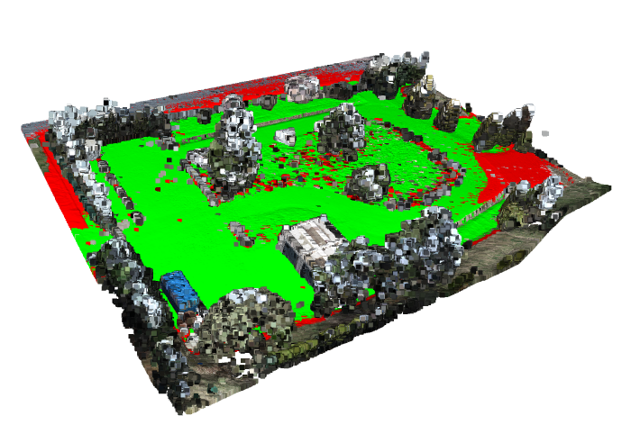
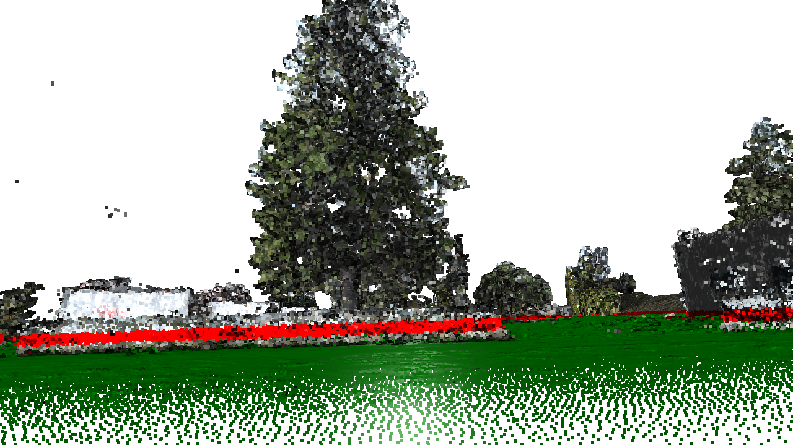

# Traversability analysis for outdoor scenarios

Geometry-based traversability analysis of 3D point clouds (E57 format) captured in outdoor environments. The pipeline fits the ground plane with RANSAC, evaluates the local slope of every point and classifies the scene into walkable ground, obstacles and high structures relative to the dimensions of a mobile robot.

Original 3D Point Cloud


---

## Features
 
- Reads large `.e57` point clouds (including RGB color) and cleans invalid or non-finite points
- Voxel-grid downsampling for fast and robust ground plane estimation
- Automatic ground detection using RANSAC plane segmentation
- Slope analysis from per-point surface normals, compared against a configurable maximum angle
- Classification of the full-resolution cloud into walkable ground, obstacles and high structures
- Robot-aware obstacle detection based on the robot height
- Fully configurable parameters (voxel size, thresholds, slope limit, RANSAC settings)
- Interactive 3D visualization with a reproducible camera viewpoint loaded from `camera.json`

---

## Technologies

- Python
- Open3D
- NumPy
- pye57

---

## Pipeline Overview

### 1. Point Cloud Loading

the first scan of an `.e57` file is read with `pye57`. Invalid and non-finite points are removed, and RGB colors are normalized when present.

### 2. Voxel Downsampling

Voxel downsampling reduces the number of points for faster processing.

### 3. Ground Estimation (RANSAC)

The dominant plane is extracted with Open3D's `segment_plane` and its normal vector is normalized.

### 4. Distance to the ground

The signed distance from *every* point of the original (full-resolution) cloud to the ground plane is computed.

### 5. Slope estimation

Normals are estimated for the full cloud (`KDTreeSearchParamHybrid`) and the angle between each normal and the ground normal is computed.

### 6. Classification

- **Walkable**: `|distance| < ground_distance_threshold` **and** `angle < max_angle_deg`
- **Obstacle**: `ground_distance_threshold <= distance <= ground_distance_threshold + c`, where `c` is the robot height
- **High structure**: remaining points


### 7. Visualization

The three clouds are shown in an Open3D window using a saved camera viewpoint (`camera.json`).

---

## Color legend
 
| Color | Class | Meaning |
|-------|-------|---------|
| Green | Walkable ground | Points close to the ground plane with a slope below the maximum allowed angle |
| Red | Obstacles | Points above the ground that fall within the robot's height range |
| Original color | High structures | Everything else (e.g. tree canopies, roofs, overhangs the robot can pass under) |

---

## Parameters
 
| Parameter | Default | Description |
|-----------|---------|-------------|
| `voxel_sz` | `0.1` | Voxel size (m) used for downsampling |
| `distance_threshold` | `0.1` | RANSAC inlier distance threshold (m) |
| `ground_distance_threshold` | `0.30` | Max distance (m) from the ground plane for a point to be considered ground |
| `max_angle_deg` | `25.0` | Maximum slope (°) for a point to be walkable |
| `ransac_n` | `3` | Number of points sampled per RANSAC iteration |
| `num_iterations` | `2500` | RANSAC iterations |
| `a, b, c` | `0.3, 0.3, 0.3` | Robot dimensions (m). `c` (height) defines the obstacle band |


---

## Project Structure

```
.
├── data/        # Input point clouds (.e57)
├── results/     # Camera viewpoint and output images
├── main.py      # Traversability analysis pipeline
└── README.md
```

---

## Requirements
 
- Python 3.9+
- [NumPy](https://numpy.org/)
- [Open3D](http://www.open3d.org/)
- [pye57](https://github.com/davidcaron/pye57)

```bash
pip install numpy open3d pye57
```

---

## Usage
 
1. Place your point cloud in the `data/` folder (e.g. `data/cloud_merged.e57`).
2. Update the file paths at the bottom of the script (point cloud and `camera.json`).
3. Adjust the parameters to match your robot and terrain.
4. Run:
```bash
python main.py
```

---

## Results

Example visualization of traversable space detection:


Green regions represent navigable terrain.\
Obstacle regions are filtered based on geometry and robot dimensions. Red regions represent this obstacles.

Point of View from the Robot


---

## Limitations and future work
 
- Assumes the ground can be approximated by a **single dominant plane**; strongly uneven terrain or multi-level scenes would need local plane fitting or a grid/elevation-based approach.
- The obstacle band depends on the robot height `c` only; the robot footprint (`a`, `b`) is not yet used.
- Possible improvements: obstacle clustering, traversability cost maps, 2D occupancy grids for path planning, and fusion with color/semantic information.

---

## Authors

David Enrique Veloz Renteria\
Maria Alejandra Guzman Alfaro\
Sara Lucía Montaño Gamarra
